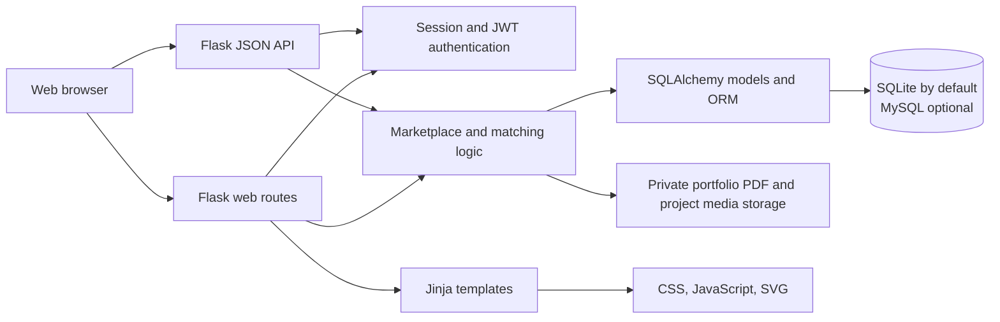
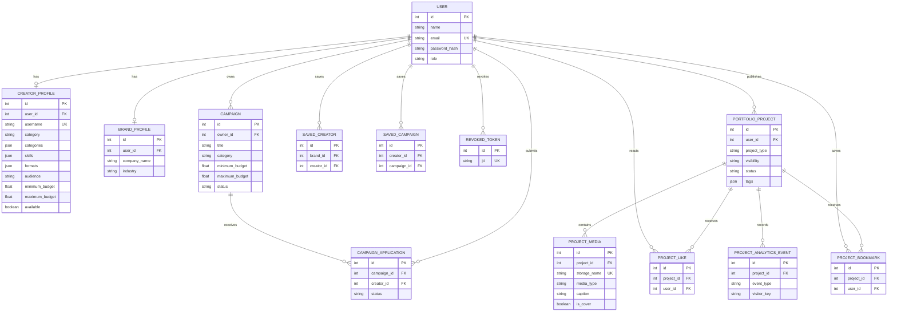

# BrandVerse AI Architecture

## Overview

BrandVerse AI is a Flask monolith. A single application serves server-rendered Jinja pages and a JSON REST API. Both interfaces use the same route handlers, SQLAlchemy models, recommendation logic, and relational database.

The current MVP does not have a separate React/Vite frontend, message broker, background worker, or paid AI service. Matching and campaign-brief generation use local deterministic rules.

## System context

## Request flow

### Server-rendered web pages

1. The browser requests a page or submits a form.
2. A Flask route in `app.py` checks the session and, where applicable, the user's role and resource ownership.
3. The route reads or updates records through the SQLAlchemy models.
4. Flask renders a Jinja template in `templates/`, or redirects after a successful form submission.
5. The browser loads shared styles and behavior from `static/css/` and `static/js/`.

State-changing web forms include a session-bound CSRF token. Passwords are stored as Werkzeug password hashes.

### JSON API

1. The client sends a JSON request to an `/api/...` endpoint.
2. Public endpoints can be read directly; protected endpoints require a bearer JWT.
3. JWT validation checks expiry and revocation. Role-sensitive routes also enforce role and ownership constraints.
4. The route validates and applies the requested operation through the same models used by the web interface.
5. The route returns a JSON response and an appropriate HTTP status.

The API is documented in [API.md](./API.md).

## Main components

| Component | Location | Responsibility |
|---|---|---|
| Application factory, web routes, API routes | `app.py` | App configuration, request handling, authentication/authorization helpers, validation, serialization, demo-data seeding, and error responses. |
| Shared database and JWT extensions | `backend/extensions.py` | Creates the SQLAlchemy and Flask-JWT-Extended extension instances used by the app. |
| Marketplace data model | `backend/models.py` | Defines users, creator and brand profiles, campaigns, applications, saved records, and revoked tokens. |
| Recommendation engine | `backend/matching/recommendation.py` | Scores creator/campaign fit and ranks creators with score components and explanations. |
| Portfolio parsing | `backend/utils/portfolio_parser.py` | Extracts text from supported PDF uploads and suggests profile fields for user review. |
| HTML interface | `templates/` | Jinja views for home, authentication, discovery, profiles, campaigns, dashboards, matching, and brief generation. |
| Browser assets | `static/` | Shared CSS, responsive navigation, reduced-motion-aware background scroll/pointer parallax JavaScript, and the BrandVerse SVG logo. The creative-universe ambient background uses CSS gradients/animations and inline SVG; it adds no frontend framework or external image/API dependency. |
| Database reference | `database/schema.sql` | MySQL-oriented reference schema; application models create tables at startup. |
| Automated tests | `tests/` | API/application behavior and recommendation-scoring tests. |

## Data model

Each account has a role (`creator`, `brand`, or `agency`). Agency accounts use the brand profile and brand-side campaign workflows in this MVP. Applications are unique per campaign/creator pair; saved relationships also have uniqueness constraints.

## Authentication and security boundaries

- Web authentication uses Flask sessions; web form POST requests require a CSRF token.
- API authentication uses short-lived JWT bearer tokens. Logout records the token identifier in `revoked_tokens`.
- Role checks protect creator-only and brand/agency-only operations. Mutations also check resource ownership.
- Passwords are stored as hashes, not plaintext.
- Authentication endpoints are rate-limited. The limiter uses in-memory storage and is not shared across multiple production workers.
- Project uploads are creator-only, checked against extension, content signature, per-file and per-request limits, and stored under random names outside static-file serving. Media downloads pass through visibility/ownership checks. Public, unlisted, private, and draft visibility are enforced on project, discovery, and media routes.
- Project POST forms use the session CSRF token. Likes, bookmarks, uploads, edits, and deletes check the signed-in user and resource ownership. Project engagement analytics use per-session pseudonymous visitor keys and do not record owner views.
- Local project media is stored under `UPLOAD_FOLDER/portfolio/`; configure durable storage, backups, and appropriate retention policies before production use. The default request limit is 100 MB, with 12 MB image and 80 MB video limits and at most 12 files per project. Portfolio PDF extraction remains capped at 5 MB and produces reviewable suggestions rather than silently modifying profile fields.
- Production mode requires explicit `SECRET_KEY` and `JWT_SECRET_KEY` configuration. Use HTTPS, secure cookies, and shared rate-limit storage in a production deployment.

## Runtime and configuration

- Python 3.10+ runs the Flask application.
- SQLite at `instance/marketplace.db` is the default database; set `DATABASE_URL` to use a configured MySQL database.
- SQLAlchemy models create the current MVP tables during app initialization. `database/schema.sql` is a reference, not the active migration system.
- Set `UPLOAD_FOLDER` to change the local PDF/project media directory and `MAX_CONTENT_LENGTH` to change the request limit. Project file limits are configurable with `MAX_PROJECT_IMAGE_BYTES`, `MAX_PROJECT_VIDEO_BYTES`, and `MAX_PROJECT_FILES` in the app configuration.
- `FRONTEND_ORIGIN` configures CORS for `/api/*`; it defaults to `http://localhost:5173` for a possible separate development client.
- `py -m flask seed-demo` inserts fictional demonstration accounts and marketplace records.

For installation and local startup instructions, see [README.md](./README.md).
